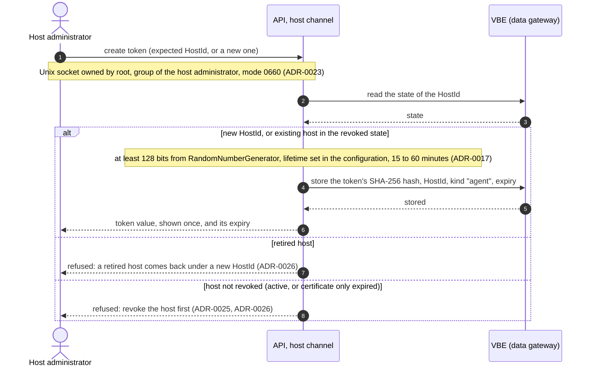
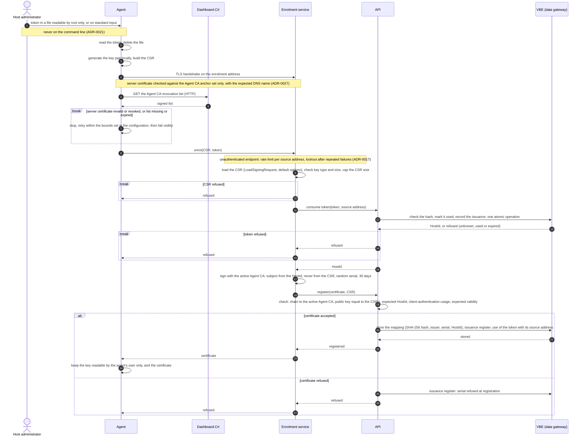
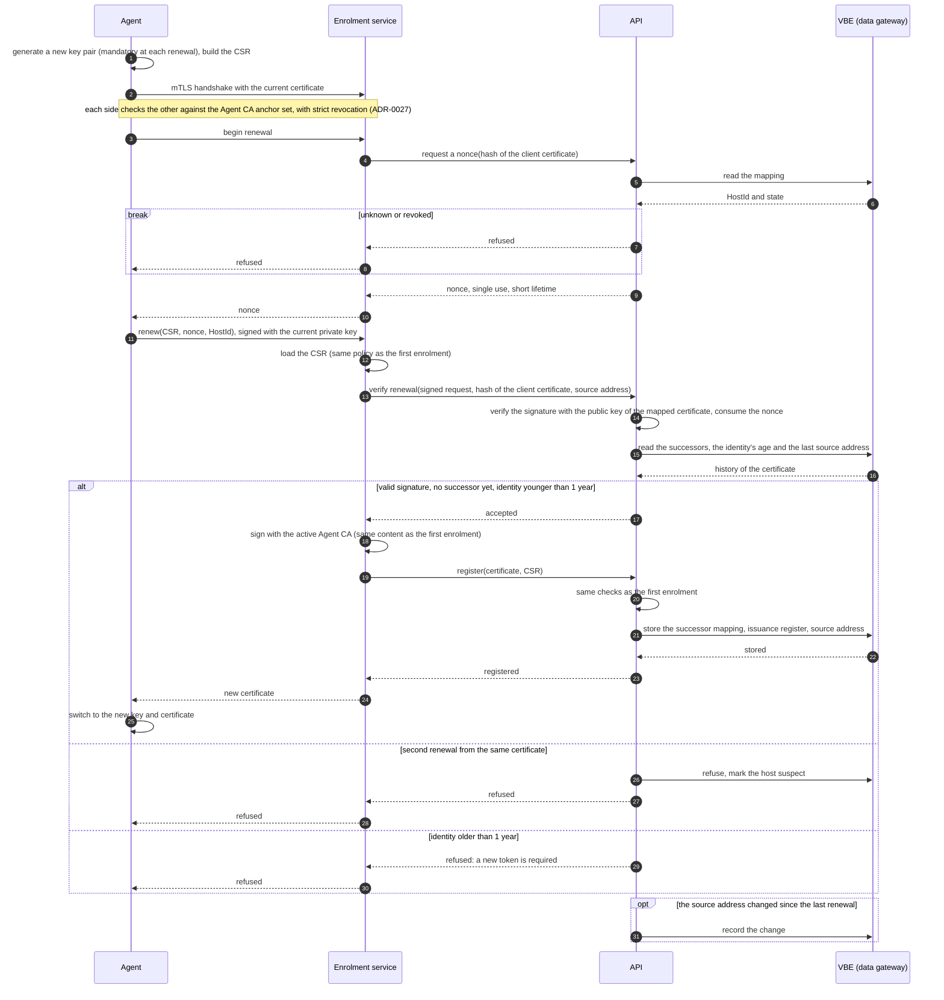
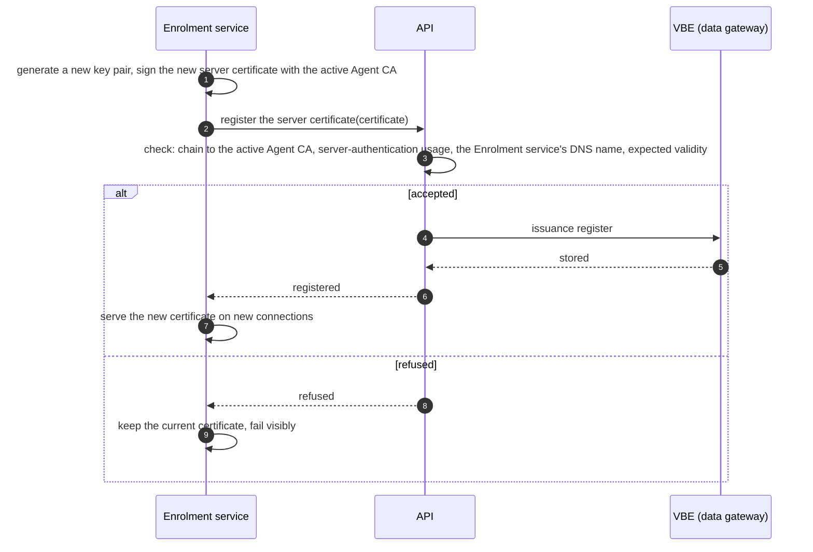

# Machine identity in 0.1: sequences

Sequence diagrams of the machine identity delivered by increment 0.1: the enrolment token, the first enrolment of an agent, the renewal of its certificate, and the renewal of the Enrolment service's own server certificate. They detail the use cases "Create an enrolment token" and "Enrol" of the [use cases of V1](../v1/use-cases.md), and follow ADR-0027, which keeps the enrolment rules of ADR-0021 and ADR-0017, with ADR-0023, ADR-0025 and ADR-0026.

The revocation of a machine and the revocation lists are in another page of 0.1, as are the heartbeat and the start-up checks. The re-key of the Agent CA is left out of 0.1: it happens about two years after installation, and how its host commands reach the Enrolment service is an open point of ADR-0027. In these diagrams, the anchor set of the Agent CA holds one anchor, its state outside a re-key.

The diagrams are written in [Mermaid](https://mermaid.js.org/) (`sequenceDiagram`), which GitHub and Obsidian render in Markdown files; the Mermaid versions they support are **not verified**. Notation:

| Element | Meaning |
|---|---|
| solid arrow | a call or a message |
| dotted arrow | the answer to a call |
| `alt` / `else` | the cases of a check: the first one is the normal path |
| `break` | the case named ends the sequence there |
| `opt` | a step that happens only in the case named |
| note | a rule that the step applies, with its source |

Every call between two processes of the "app" VM goes over a Unix domain socket, with a deadline (ADR-0004). The VBE (data gateway) is the only process that connects to SQL Server; the API reaches it through its `manage` socket (ADR-0004, ADR-0005).

## Create an enrolment token

The host administrator creates a token on the "app" VM, through the host channel of the API (ADR-0023). From 0.2, an Admin can also create one in the web site, after step-up (ADR-0021, ADR-0026); that path is drawn with the 0.2 sequences.

- Only the hash of the token is stored, and it is compared in constant time when the token is used (ADR-0017). No role ever sees the value again (ADR-0026).
- The host commands are audited from 0.2, when the audit trail exists (ADR-0023, ADR-0026). In 0.1, the only record is the issuance register, which records issuances and revocations, not the creation of tokens (ADR-0021).
- "Monitor" tokens, for the verifier, are created on the same host channel and never in the web site (ADR-0026). The verifier arrives in 0.2 (ADR-0025), so they are drawn with the 0.2 sequences.

## First enrolment

The host administrator delivers the token out of band and installs the agent from the signed RPM package (ADR-0025). The package carries the two trust anchors, the two DNS names and the enrolment address; no trust material is fetched at enrolment time (ADR-0017).

- The token is consumed before the certificate is signed, so it can never be used twice (ADR-0017). If anything fails after this step, the token is lost, and the host administrator creates a new one.
- A certificate refused by the API is never mapped, so the Collector refuses it: the mapping fails closed (ADR-0027).
- Each use of a token is shown on the dashboard with the source address of the request (ADR-0025); in 0.1, on the development status page.
- The Agent CA revocation list served by `Dashboard.Crl` is written by the Enrolment service; the sequence that produces it is drawn with the revocation of a machine.

## Renewal of the agent certificate

The agent renews its certificate at two thirds of its life, that is after 20 of its 30 days (ADR-0017). Renewal requires the current client certificate, and the API verifies the request itself: it never accepts a statement of the Enrolment service as proof (ADR-0017).

- **One successor** per certificate: a second renewal from the same certificate is refused, and the host is marked suspect (ADR-0017).
- The old certificate is revoked at the end of the overlap (ADR-0017); that step is drawn with the revocation of a machine.
- ADR-0017 alerts a second renewal and a change of source address. The alert channel arrives in 0.2 (ADR-0025): in 0.1, these events are recorded and shown on the development status page.

## Renewal of the Enrolment service's server certificate

The Enrolment service renews its own server certificate, valid 90 days, itself (ADR-0017). It signs it with the Agent CA, whose key it holds online.

- Every issuance is recorded (ADR-0017), the Enrolment service's own certificate included; this is what lets the reconciliation of ADR-0017 tell it from an unknown certificate.

## Proposed by these diagrams, to be decided

The ADRs do not settle the points below; the diagrams draw them as proposed here.

1. **Two calls from the Enrolment service to the API** at enrolment and renewal: one before signing (consume the token, or verify the renewal), one after (register the certificate, with the CSR, so that the API can compare the public keys).
2. **A certificate refused at registration** is recorded in the issuance register with its serial, so that the reconciliation of ADR-0017 does not report it as unknown. Whether it is also put on the Agent CA revocation list is decided with the revocation sequences.
3. **The renewal nonce** is requested by a separate first call, is single use, and its lifetime is set in the configuration.
4. **The agent reads the token, then deletes the file at once**, before the enrolment answer: a failed attempt therefore needs a new token, which a consumed token needs anyway.
5. **In 0.1, before the alert channel**, the events that ADR-0017 alerts (second renewal, change of source address) are recorded and shown on the development status page.
6. **The Enrolment service's server certificate** goes through the API's checks and the issuance register like an agent certificate.
