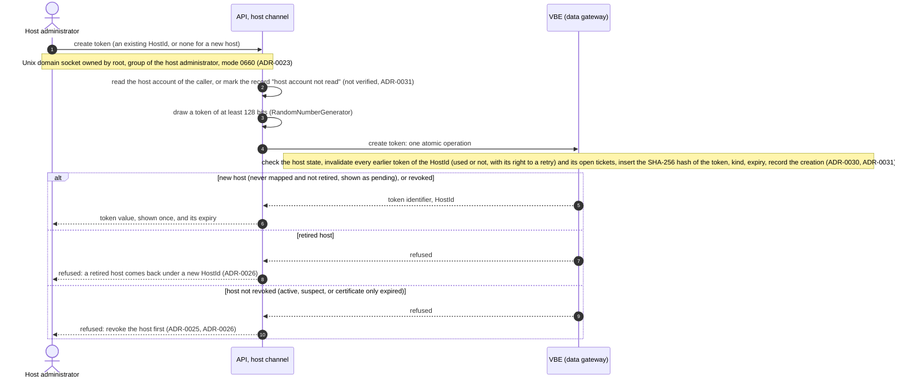
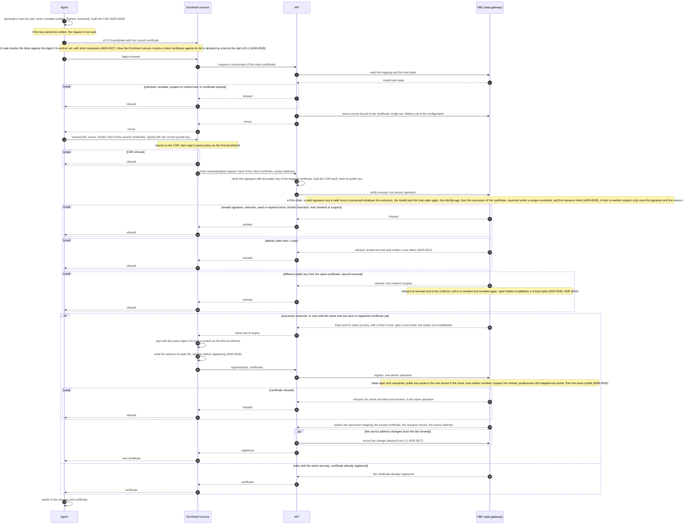
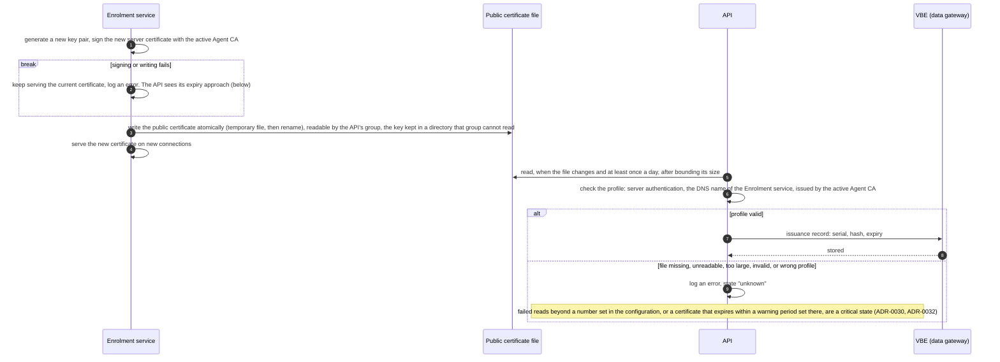

# Machine identity in 0.1: sequences

Sequence diagrams of the machine identity delivered by increment 0.1: the enrolment token, the first enrolment of an agent, the renewal of its certificate, and the record of the Enrolment service's own server certificate. They detail the use cases "Create an enrolment token" and "Enrol" of the [use cases of V1](../v1/use-cases.md).

They follow ADR-0027, ADR-0030 and ADR-0031, with ADR-0023, ADR-0025, ADR-0026, ADR-0029 and ADR-0032. ADR-0017 and ADR-0021 are superseded, but they are cited **on purpose**, because ADR-0027 keeps their details ("ADR-0021 holds the details"): ADR-0017 holds the token lifetime, the renewal at two thirds of the certificate's life and the one-successor rule, and ADR-0021 the creation of tokens on the host and the token file.

The revocation of a machine and the revocation lists are drawn in another page of 0.1, as are the heartbeat and the start-up checks. The re-key of the Agent CA is left out of 0.1: it happens about two years after installation, and how its host commands reach the Enrolment service is an open point of ADR-0027. In these diagrams, the anchor set of the Agent CA holds one anchor, its state outside a re-key.

The diagrams are written in [Mermaid](https://mermaid.js.org/) (`sequenceDiagram`), which GitHub and Obsidian render in Markdown files; the Mermaid versions they support are **not verified**. Notation:

| Element | Meaning |
|---|---|
| actor | a person |
| participant | a process, or a file |
| number | the step, to be quoted in reviews |
| solid arrow | a call or a message; an arrow to itself is a step done inside the process |
| dotted arrow | the answer to a call |
| `alt` / `else` | the cases of a check: the first one is the normal path |
| `break` | the case named ends the sequence there |
| `opt` | a step that happens only in the case named |
| note | a rule that the step applies, with its source |

Rules that apply to every diagram, and are not repeated in each one:

- Every call between two processes of the "app" VM goes over a Unix domain socket, with a deadline (ADR-0004). The VBE (data gateway) is the only process that connects to SQL Server; the API reaches it through its `manage` socket (ADR-0004, ADR-0005).
- **A callee that cannot be reached, or a deadline that is exceeded, ends the call with a failure, never with an acceptance.** The failure is logged with its context, and the caller retries only within bounds set in its configuration (CLAUDE.md, section 4). The mapping fails closed (ADR-0027).
- **A local step that fails** (a file that cannot be written, read or deleted) stops the process at that step, with an error and a clear message; it is never skipped.
- A token value is never logged, in any process (ADR-0017). A refusal is logged and recorded without it, and the machine always receives the same generic refusal (ADR-0031).
- A **critical state** (a suspect host, a token presented again, a certificate about to expire, and the others of ADR-0032) is logged at critical level and listed by the host command "status" from 0.1, and alerted from 0.2 (ADR-0025, ADR-0032).

## Create an enrolment token

The host administrator creates a token on the "app" VM, through the host channel of the API (ADR-0021, ADR-0023). From 0.2, an Admin can also create one in the web site, after step-up (ADR-0023, ADR-0026); that path is drawn with the 0.2 sequences.

- The lifetime of a token is 15 to 60 minutes (ADR-0017); the value is set in the configuration (CLAUDE.md, section 9).
- The database keeps the hash of the token, never its value. No role ever sees the value again (ADR-0026, ADR-0031).
- The API draws the `HostId` of a new host (see "Not decided yet").
- From 0.1, the issuance register records the creation of the token, with the host account that ran the command, or the mark "host account not read" (ADR-0031). The host commands themselves are audited from 0.2, when the audit trail exists (ADR-0023, ADR-0026).
- "Monitor" tokens, for the verifier, are created on the same host channel and never in the web site (ADR-0026). The verifier arrives in 0.2 (ADR-0025), so they are drawn with the 0.2 sequences.

## First enrolment

The host administrator installs the agent from the signed RPM package (ADR-0025), which carries the Server CA anchor, the Agent CA anchor set, the two DNS names and the enrolment address; no trust material is fetched at enrolment time (ADR-0017, ADR-0027). The host administrator then runs the one-shot enrolment command, as root (ADR-0031).

```mermaid
sequenceDiagram
    autonumber
    actor HostAdmin as Host administrator
    participant Cmd as Enrolment command (root)
    participant Crl as Dashboard.Crl
    participant Enrol as Enrolment service
    participant Api as API
    participant VBE as VBE (data gateway)

    HostAdmin->>Cmd: run, with the token typed at a prompt without echo (a file is the fallback)
    Note over HostAdmin,Cmd: never on the command line nor in an environment variable (ADR-0021, ADR-0031). A file is opened without following links, and only if it is owned by root with mode 0400 or 0600 (ADR-0031)
    break the agent already holds a valid certificate
        Cmd-->>HostAdmin: refused: revoke the host first (ADR-0026, ADR-0031)
    end
    Cmd->>Cmd: reuse the pending key bound to the hash of this token, or generate a new one, written durably to the pending path, readable by root only (ADR-0031)
    Cmd->>Enrol: TLS handshake on the enrolment address
    Cmd->>Crl: during the handshake: GET the Agent CA revocation list (HTTP, deadline of a few seconds)
    Crl-->>Cmd: signed list
    Note over Cmd,Enrol: the server certificate is checked against the Agent CA anchor set only, with the expected DNS name. The list is checked: signature and issuer, nextUpdate, serial of the server certificate (ADR-0017, ADR-0027)
    break server certificate invalid or revoked, or list missing, invalid or expired
        Cmd->>Cmd: stop, the token is not sent. Retry within the configured bounds, then fail visibly
    end
    Cmd->>Enrol: enrol(CSR, token)
    Cmd->>Cmd: delete the token file, keep the token in memory for the retries (ADR-0031)
    Note over Enrol: rate limit per source address, bound on the request size, bound in bytes on the CSR, then load the CSR (ADR-0030)
    break rate limit or a bound exceeded, or CSR refused (signature, key type and size)
        Enrol-->>Cmd: refused (generic): the command stops, without a retry
    end
    Enrol->>Api: consume token(token, CSR, source address)
    Api->>Api: load the CSR itself (same policy), hash its public key, hash the token
    Api->>VBE: consume token: one atomic operation
    Note over VBE: find by the hash of the token, compare it in constant time. First, is it a retry (same token, same public key, token unexpired and still the latest of the host)? Otherwise: check unused and unexpired, check the host again (new or revoked, not retired, no active mapping, no open ticket), mark used, create the issuance ticket bound to the HostId, the kind and the hash of the public key (ADR-0030, ADR-0031)
    break token refused (unknown, used, expired, invalidated, no longer the latest, host state)
        VBE-->>Api: refused, recorded with its reason and the source address
        Note over VBE: a token presented again once used, expired or invalidated is a suspect event, a critical state, except an honest late retry with the same public key (ADR-0031, ADR-0032)
        Api-->>Enrol: refused
        Enrol-->>Cmd: refused (generic): the command stops, without a retry
    end
    alt token accepted, or retry with no registered certificate yet
        VBE-->>Api: ticket and its expiry (a retry gets a new ticket, the earlier one invalidated)
        Api-->>Enrol: ticket and its expiry
        Enrol->>Enrol: sign with the active Agent CA: subject from the HostId, never from the CSR, random serial, 30 days
        Enrol->>Enrol: write the serial to its state file, durably, before registering (ADR-0030)
        Enrol->>Api: register(ticket, certificate)
        Api->>VBE: register: one atomic operation
        Note over VBE: ticket open and unexpired, public key equal to the one bound in the ticket, host state checked again (not retired, no active mapping, the token of the ticket still the latest of the host, a revoked host being accepted as the way back), then the exact profile: listed extensions only, CA=false, client authentication only, no subject alternative name, unique serial, SHA-256 or stronger, issuer the active Agent CA, validity (ADR-0030)
        break certificate refused
            VBE-->>Api: refused: the serial recorded as refused at registration and revoked, in the same operation (ADR-0030)
            Api-->>Enrol: refused
            Enrol-->>Cmd: refused (generic): the command stops, without a retry
        end
        VBE-->>Api: stored: the mapping (SHA-256 hash, issuer, serial, HostId), the issued certificate, the issuance record, the use of the token with its source address. The host is active, its suspect mark lifted if any
        Api-->>Enrol: registered
        Enrol-->>Cmd: certificate
    else retry, certificate already registered
        VBE-->>Api: the certificate already registered
        Api-->>Enrol: certificate
        Enrol-->>Cmd: certificate
    end
    Cmd->>Cmd: move the pending key and the certificate to the agent's user (ADR-0031)
```

- The token is consumed before the certificate is signed, so it can never enrol two machines (ADR-0017, ADR-0031). The command retries after a transport failure only; a refusal stops it.
- A retry with the same token and the same key, after a lost answer, gets the certificate already registered, or a new ticket for the same key, while the token is unexpired and still the latest. A run of the command with the same token reuses the pending key of the earlier run. After the token has expired, the host administrator creates a new token, which invalidates the earlier token, its retries and its open ticket; the command says so (ADR-0031).
- The same path enrols a revoked host again, the yearly re-enrolment included (ADR-0030, ADR-0031).
- If the registration does not succeed (the API cannot be reached, a deadline), the Enrolment service retries within its configured bounds, never after the expiry of the ticket. The certificate is then never mapped, so the Collector refuses it (ADR-0027); the API sees the expired ticket itself, reads the serial from the state file, and revokes it (ADR-0030, ADR-0032).
- If the token file cannot be deleted, the command stops with an error; a rerun with the same token is a retry while the token is unexpired.
- If the command cannot store the key and the certificate, it fails visibly. The certificate stays mapped, and a rerun with the same token gets the same certificate while the token is unexpired.
- An abandoned pending host is revoked, which also invalidates its unused tokens, then retired (ADR-0026, ADR-0031).
- The Agent CA revocation list can be replayed over plain HTTP while it is valid, up to 7 days: it is signed, so it cannot be changed, only replayed (ADR-0025).
- **Residual risk** (ADR-0031): the Enrolment service terminates the TLS, so it sees the token. A compromised Enrolment service can consume it with its own key, and enrol one machine per token in place of the real one. The real machine is then refused, which is visible. The source address it passes to the API is its own statement (ADR-0030).

## Renewal of the agent certificate

The agent renews its certificate at two thirds of its life, that is after 20 of its 30 days (ADR-0017). Renewal requires the current client certificate, and the API reads the new public key itself, from the request that the agent signed (ADR-0030).

- If a renewal fails, the agent retries within bounds set in its configuration. It reports in its heartbeat the days before its certificate expires (ADR-0021); within a number of days set in the configuration, this is a critical state (ADR-0032). If the certificate expires (after 30 days), the Collector refuses the host, which is "down: refused": the host administrator revokes it and creates a new token (ADR-0026, ADR-0031).
- If the agent cannot store the new certificate, it fails visibly and retries with the same new key: the retry gets the certificate already registered.
- The registration failures of the first enrolment (bounded retries, the serial from the state file revoked) apply in the same way at renewal (ADR-0030, ADR-0032).
- The old certificate is revoked at the end of the **renewal overlap** (ADR-0017); that step is drawn with the revocation of a machine.
- The end of the 1-year identity is shown in advance on the host page, and a yearly procedure is written in `doc/adm/` (ADR-0031).

## Record of the Enrolment service's server certificate

The Enrolment service renews its own server certificate, valid 90 days (ADR-0017), at a time set in its configuration (ADR-0030). The API records it by reading its public file; nothing is added to the socket between the two services (ADR-0030).

- The API tracks the expiry of this certificate, and raises the critical state within the warning period, before the expiry. If it expires, the agents refuse the enrolment channel (strict checks, ADR-0027): no enrolment and no renewal works until it is renewed.
- **Limit** (ADR-0030): the record holds what the file contains, not what the service serves. A compromised Enrolment service holds the Agent CA key and can serve a certificate it never wrote to the file.

## Not decided yet

The ADRs do not settle the points below. The diagrams draw them as written here.

1. **The renewal overlap**: how long the old certificate stays valid after a renewal before it is revoked (ADR-0017 does not define it). Until it is decided, the old certificate stays a valid credential for the thief of an old key during that time. To decide with the revocation sequences.
2. **One listener or two** for the Enrolment service: the enrolment uses server-side TLS, the renewal mutual TLS. Whether Kestrel serves both on one listener with an optional client certificate, or two ports are needed, is **not verified**. With one listener, "begin renewal" must refuse a call without a client certificate, the first enrolment must ignore any client certificate, and the intake order of ADR-0030 applies to both.
3. **Who draws a new `HostId`**: the diagrams have the API draw it at the creation of the first token of a new host.

The points that the ADRs mark **not verified** apply as written there, and the diagrams draw them as if they hold:

- that .NET opens a file without following links and reads the owner of an open file (ADR-0031);
- that the host account can be read from the peer credentials of the host channel's socket (ADR-0031);
- how the Collector and the Enrolment service check an agent certificate against the list they loaded (ADR-0029);
- that several Agent CA anchors are each accepted on Linux (ADR-0027).

The delivery of the enrolment command on Windows is decided with the Windows agent, in 0.4 (ADR-0031).
