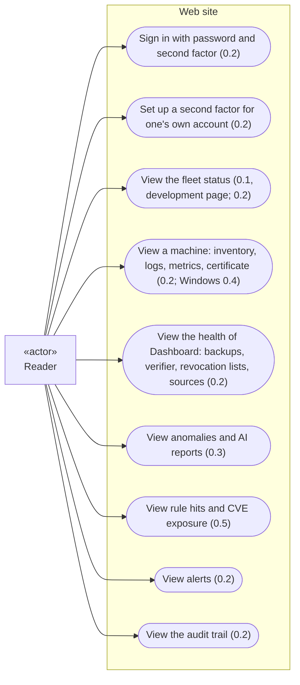
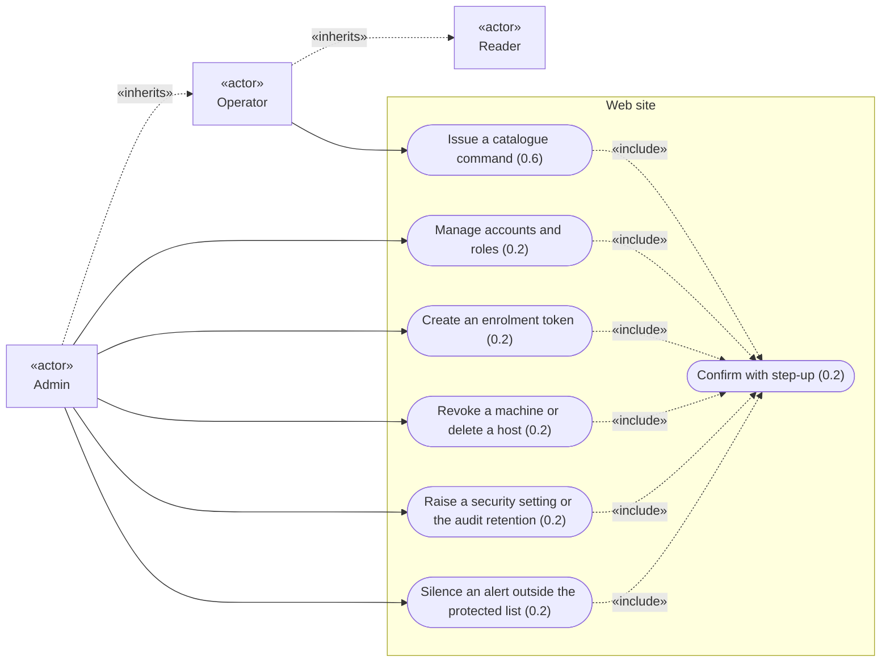
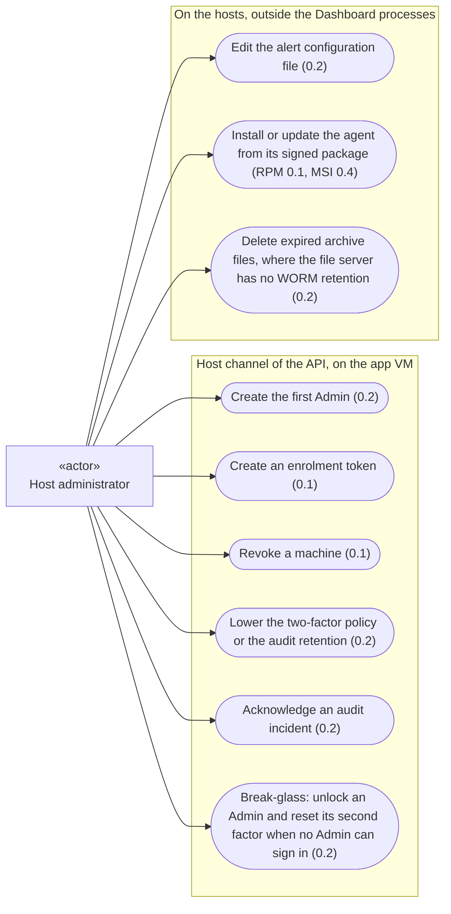
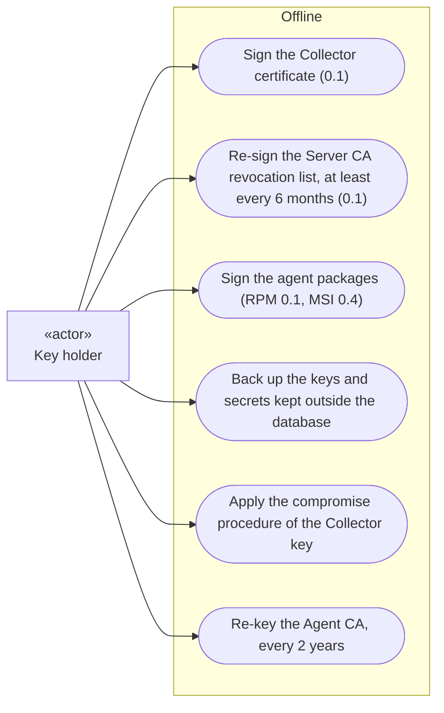
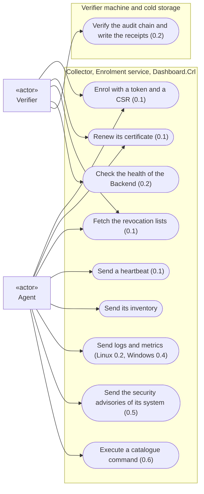
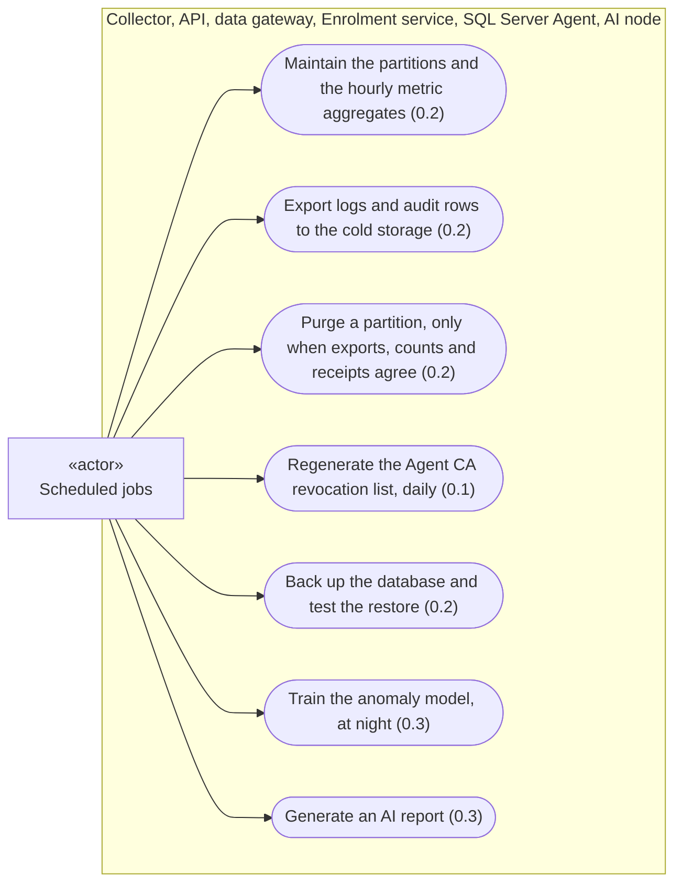

# Use cases of V1

Overview of what each actor can do with Dashboard in V1, drawn from the accepted ADRs. Each use case carries the increment that delivers it (ADR-0015, ADR-0025). The detail of each use case (its steps and its failures) is given by the sequence diagrams of its increment. The work that the system does on its own, without an actor's goal, is listed under [Left out of this overview](#left-out-of-this-overview). The points that the diagrams draw but no ADR decides are listed under [Not decided](#not-decided-or-not-stated-by-an-adr): they wait for the product owner.

The diagrams are written in [Mermaid](https://mermaid.js.org/), which GitHub and Obsidian render in Markdown files. They use the flowchart syntax, because Mermaid's dedicated use case diagram is still in beta (Mermaid documentation, *Use case diagrams*) and the Mermaid versions that GitHub and Obsidian support are **not verified**. Notation:

| Shape | Meaning |
|---|---|
| rectangle with «actor» | actor: a person, a tool, or time |
| rounded box | use case |
| box around use cases | where the use case runs |
| solid arrow | the actor takes part in the use case |
| dotted arrow «include» | the use case always includes the other one |
| dotted arrow «inherits» | the role has every right of the other role |

## Actors

| Actor | Kind | Who or what | Source |
|---|---|---|---|
| Reader | person, web site | sees everything, changes nothing | ADR-0023 (roles kept from ADR-0019; rights defined in ADR-0014) |
| Operator | person, web site | Reader, plus issuing the commands of the catalogue | as above |
| Admin | person, web site | Operator, plus accounts, roles and configuration | as above |
| Host administrator | person, on the "app" VM and on the supervised machines | runs the host commands through the host channel of the API; installs the agents | ADR-0023, ADR-0025 |
| Key holder | person, offline | holds the Server CA key and the package signing keys, which never reach the "app" VM; backs up offline the keys and secrets kept outside the database | ADR-0021, ADR-0022, ADR-0025 |
| Agent | Dashboard program, on each supervised machine | enrols, reports, executes catalogue commands | ADR-0011, ADR-0016, ADR-0021, ADR-0024 |
| Verifier | Dashboard tool, on another machine than the "app" VM | the independent verification tool, enrolled with a "monitor" identity | ADR-0022, ADR-0024, ADR-0025 |
| Scheduled jobs | time | systemd timers on Linux, SQL Server Agent for the backups | ADR-0010, ADR-0012, ADR-0021, ADR-0022, ADR-0024 |

The host administrator and the key holder can be the same person. They are two actors because they hold different rights: the host channel on the "app" VM, and keys that never reach it.

## Reader

- The status page of 0.1 is for development only and is never deployed elsewhere (ADR-0015).
- When the Collector or the data gateway cannot be reached, the whole fleet is shown as "unknown", never as "down" nor as "up" (ADR-0022). A machine whose certificate is refused is shown "down: refused", one that does not connect "down: silent" (ADR-0021).
- Anomaly scoring is shown as "unavailable" when the model cannot be loaded, never as "no anomaly"; a source absent from the training data is "not covered by the model"; a failed report is shown as failed, never replaced by an older one (ADR-0009).
- The audit views mark the entries of 0.1 as "recorded before the audit trail, not proven" (ADR-0025).

## Operator and Admin

- The list of actions under step-up is the one of ADR-0023.
- The critical alerts listed in ADR-0025 cannot be silenced from the web site.
- Lowering a security setting is not possible from the web site: it goes through the host channel (ADR-0023).
- While an audit incident is open, every audited action is refused until the host administrator acknowledges it (ADR-0024).
- A token can be created only for a new host, or for one without an active certificate (ADR-0025).

## Host administrator

- In 0.1, token creation and revocation are recorded only in the issuance register; when 0.2 is installed, the register entries are written into the audit trail, marked "recorded before the audit trail, not proven" (ADR-0021, ADR-0025).
- From 0.2, every host command is audited with the host account that ran it (ADR-0023), and a machine revoked, a lowered setting and a break-glass unlock raise a critical alert (ADR-0025).
- Expired archive files are deleted by an administrator account of the file server, never by a Dashboard account (ADR-0024). The right to erasure in the archive files follows a procedure written in the administration documentation before V1 (ADR-0012).

## Key holder

- The Server CA revocation list is valid 12 months and alerted 60 days before its `nextUpdate`; with strict revocation, an expired list cuts every agent off (ADR-0021).
- The compromise procedure and the re-key both deliver the new trust anchor in an agent update, never through the Collector (ADR-0021, ADR-0025). The agents that do not have it yet are reported on the dashboard.
- The list of keys and secrets to back up is in ADR-0022.

## Agent and verifier

- The connection is always opened by the agent; no inbound port is opened on the supervised machines (ADR-0004).
- Revocation is strict: a missing, expired or unreachable revocation list is a failure, and the connection is refused (ADR-0021).
- The verifier is enrolled with a token of kind "monitor"; its identity can call the health service of the Collector, nothing else (ADR-0025). It never connects to the database (ADR-0024).
- The verifier runs under a systemd timer, every hour (ADR-0024). It raises its own critical alerts, through its own configuration, when a copied file differs, when sequence numbers are missing, when the newest file is too old, or when the Backend does not answer (ADR-0022, ADR-0024).
- Agent updates never go through the Collector nor through remote commands (ADR-0025).

## Scheduled jobs

- The audit rows are also exported right after each audited security event, not only every hour (ADR-0024).
- The purge is refused, with an alert, when the exported counts differ, when the partition is too young, or when the verifier's receipts do not cover every sequence number of an audit partition (ADR-0022, ADR-0024). If the verifier stops, no audit partition can be purged.
- The age of the last backup of each kind and the result of the last restore test are shown on the dashboard and alerted (ADR-0022).
- Training and reports never run at the same time; training is scheduled at night (ADR-0010).

## Left out of this overview

Work that the system does on its own, as part of the use cases above, without a goal of its own for an actor. It belongs to the sequence diagrams:

- anomaly scoring as data arrives (0.3) and the real-time rules (0.5) in the Collector (ADR-0009);
- the .NET preparation and pseudonymisation of the training data (0.3; ADR-0009, ADR-0012);
- the self-heartbeats of the API, the data gateway and the Collector (0.2, ADR-0025);
- the alerts sent by the Backend by e-mail and webhook (0.2, ADR-0022);
- the reconciliation counters of the batches (0.2, ADR-0022).

## Not decided, or not stated by an ADR

These points wait for the product owner. The diagrams draw a choice only where it is marked "drawn as".

1. **Rights of the roles.** They are written only in ADR-0014, superseded by ADR-0019, itself superseded by ADR-0023, which keeps the roles without restating their rights. No accepted ADR restates the table.
2. **Role for revoking a machine, deleting a host, and silencing an alert** from the web site. ADR-0023 puts these actions under step-up without naming the role. Drawn as Admin. "Delete a host" is not defined further by any ADR.
3. **What triggers an AI report**: a schedule, a request, or both. ADR-0009 says that the API calls the LLM; ADR-0010 speaks of reports "requested", without saying by whom. Drawn as a scheduled job.
4. **Who creates a "monitor" token**: the host channel, the web site, or both (ADR-0025 does not say).
5. **Whether the other critical alerts of the catalogue** (ADR-0022), outside the list of ADR-0025, can be silenced from the web site.
6. **Whether each user sets up their own second factor.** ADR-0023 says that an authenticator key is shown once when it is generated, and that an Admin can reset a second factor; that the user sets it up is implied.
7. **Increment of the inventory and of the key backup.** The agent sends an inventory (ADR-0004, ADR-0016), shown on the machine page of 0.2; the key backup is described in ADR-0022. No ADR gives the increment of either.
8. **Frequency of the training** (ADR-0010 says "at night", not how often).
