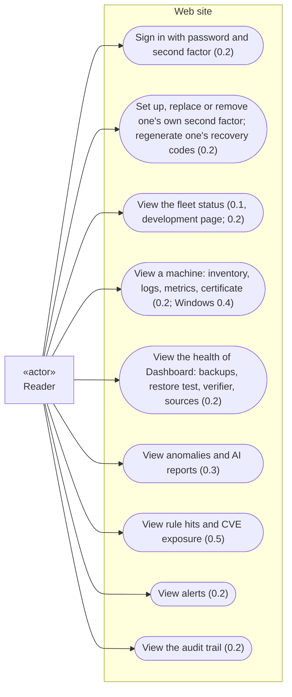
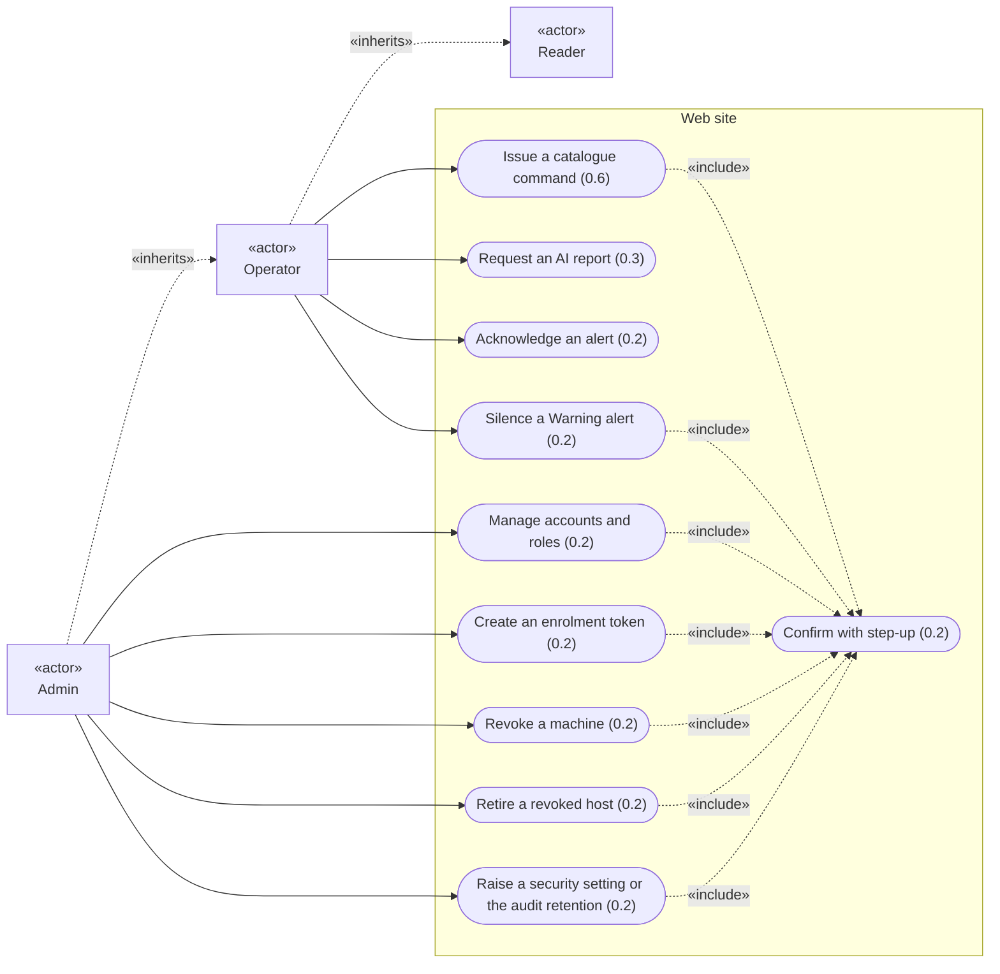
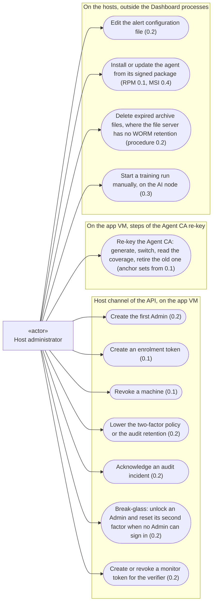
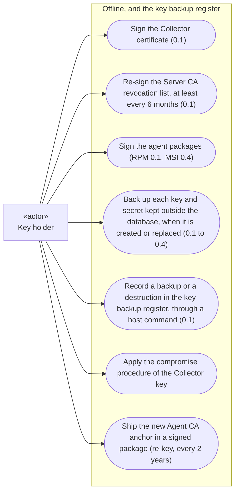
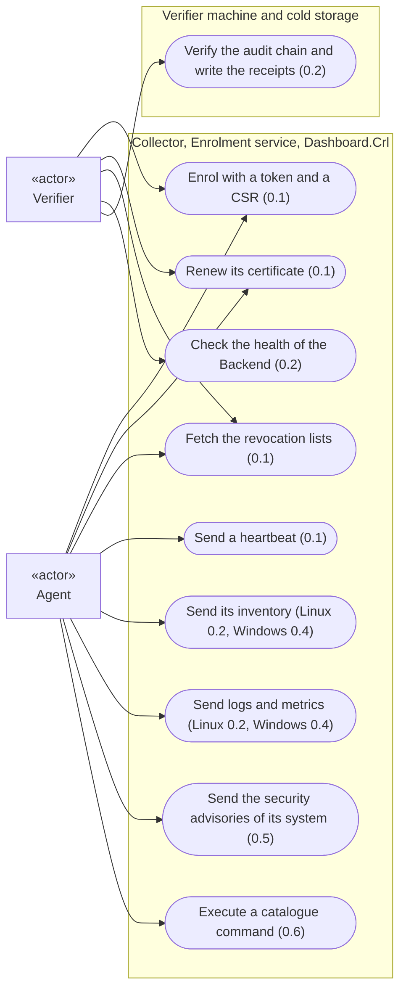
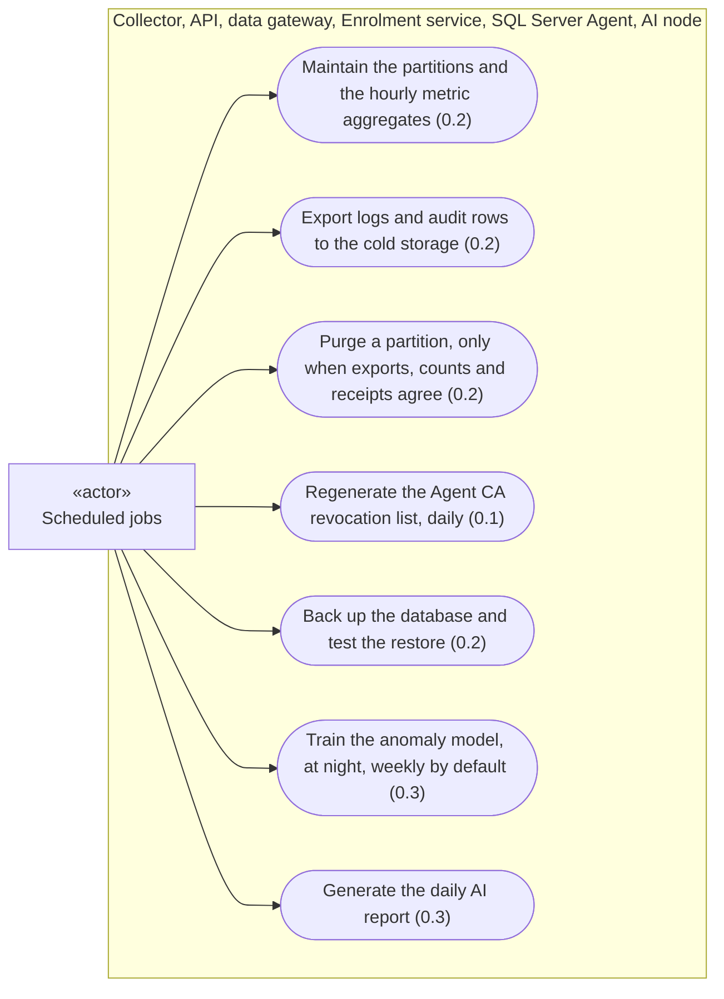

# Use cases of V1

Overview of what each actor can do with Dashboard in V1, drawn from the accepted ADRs. Each use case carries the increment that delivers it (ADR-0015, ADR-0025). The detail of each use case (its steps and its failures) is given by the sequence diagrams of its increment. The work that the system does on its own, without an actor's goal, is listed under [Left out of this overview](#left-out-of-this-overview). The rights of each role and of the host channel are gathered in ADR-0026, which settled the points this overview first raised; the points still open are listed under [Open points](#open-points).

The diagrams are written in [Mermaid](https://mermaid.js.org/), which GitHub and Obsidian render in Markdown files. They use the flowchart syntax, because Mermaid's dedicated use case diagram is still in beta (Mermaid documentation, *Use case diagrams*) and the Mermaid versions that GitHub and Obsidian support are **not verified**. Notation:

| Shape | Meaning |
|---|---|
| rectangle with «actor» | actor: a person, a tool, or time |
| rounded box | use case |
| box around use cases | where the use case runs |
| solid arrow | the actor takes part in the use case |
| dotted arrow «include» | the use case always includes the other one |
| dotted arrow «inherits» | the role has every right of the other role |

## Actors

| Actor | Kind | Who or what | Source |
|---|---|---|---|
| Reader | person, web site | sees everything except the value of enrolment tokens and the sessions of other users; changes nothing but their own second factor | ADR-0026 |
| Operator | person, web site | Reader, plus catalogue commands, AI report requests, acknowledging alerts, silencing Warning alerts | ADR-0026 |
| Admin | person, web site | Operator, plus accounts, roles, configuration, enrolment tokens, revoking machines, retiring hosts | ADR-0026 |
| Host administrator | person, on the "app" VM and on the supervised machines | runs the host commands through the host channel of the API; installs the agents; carries out the Agent CA re-key on the "app" VM | ADR-0023, ADR-0025, ADR-0026 |
| Key holder | person, offline | holds the Server CA key, which never reaches the "app" VM (ADR-0027), and the package signing keys, kept offline (ADR-0025); backs up offline the keys and secrets kept outside the database (ADR-0022, ADR-0026) and records each backup in the key backup register | ADR-0022, ADR-0025, ADR-0026, ADR-0027 |
| Agent | Dashboard program, on each supervised machine | enrols, reports, executes catalogue commands | ADR-0011, ADR-0016, ADR-0024, ADR-0027 |
| Verifier | Dashboard tool, on another machine than the "app" VM | the independent verification tool, enrolled with a "monitor" identity | ADR-0022, ADR-0024, ADR-0025 |
| Scheduled jobs | time | systemd timers on Linux, SQL Server Agent for the backups | ADR-0010, ADR-0012, ADR-0022, ADR-0024, ADR-0027 |

The host administrator and the key holder can be the same person. They are two actors because they hold different rights: the host channel on the "app" VM, and keys kept offline.

## Reader

- The status page of 0.1 is for development only and is never deployed elsewhere (ADR-0015).
- Changing one's own second factor or recovery codes needs step-up, for every role. A recovery code is not a step-up proof, except to replace a lost factor, which raises a critical alert and invalidates the remaining codes. On an Operator or Admin account, adding or replacing a factor, regenerating the recovery codes and signing in with a recovery code each raise a critical alert. Under the policy "required", an Operator or Admin account without a factor must set one up at its next sign-in, and cannot remove it (ADR-0026).
- When the Collector or the data gateway cannot be reached, the whole fleet is shown as "unknown", never as "down" nor as "up" (ADR-0022). A machine whose certificate is refused is shown "down: refused", one that does not connect "down: silent" (ADR-0027).
- Anomaly scoring is shown as "unavailable" when the model cannot be loaded, never as "no anomaly"; a source absent from the training data is "not covered by the model"; a failed report is shown as failed, never replaced by an older one (ADR-0009).
- The audit views mark the entries of 0.1 as "recorded before the audit trail, not proven" (ADR-0025).
- Each use of an enrolment token is shown with the source address of the request (ADR-0025). The audit trail records the identifier of a token or a session, never its value (ADR-0026).

## Operator and Admin

- The list of actions under step-up is the one of ADR-0023, as changed by ADR-0026; revoking a machine and retiring a host need a single-use proof.
- No critical alert can be silenced from the web site: it can only be acknowledged. Every open critical alert, acknowledged or not, is notified again at an interval set on the host, and the dashboard shows its age. Silencing applies to one Warning alert, within a duration and a number of renewals set in the host's configuration file; the dashboard shows who silenced it and until when (ADR-0026).
- Acknowledging the "audit incident" alert does not lift the block: only the host command does (ADR-0024, ADR-0026).
- A host is never deleted. Only a host revoked explicitly can be retired; a connection attempt with the certificate of a retired host raises one critical alert per host, which counts further attempts; a machine that comes back is enrolled under a new `HostId` (ADR-0026).
- AI report requests are rate-limited; a refused request returns "limit reached, retry at T"; a request during training is refused with its reason; a failed or late daily report raises a Warning (ADR-0026).
- Lowering a security setting is not possible from the web site: it goes through the host channel (ADR-0023).
- While an audit incident is open, every audited action is refused until the host administrator acknowledges it (ADR-0024).
- A token can be created only for a new host, or for a host in the revoked state; a host whose certificate has only expired must be revoked first; never for a retired host (ADR-0025, tightened by ADR-0026).

## Host administrator

- In 0.1, token creation and revocation are recorded only in the issuance register; when 0.2 is installed, the register entries are written into the audit trail, marked "recorded before the audit trail, not proven" (ADR-0027, ADR-0025).
- From 0.2, every host command is audited with the host account that ran it (ADR-0023), and a machine revoked, a lowered setting, a break-glass unlock (ADR-0025) and a monitor identity created or revoked (ADR-0026) raise a critical alert.
- The key holder records each offline backup in the key backup register through a host command; from 0.2, a missing or outdated backup raises a Warning (ADR-0026).
- How the re-key steps reach the Enrolment service, which the host channel of the API does not drive, is decided when the 0.1 work starts (ADR-0027). Retiring the old Agent CA is refused while a host is not covered or unknown, unless an audited override is given (ADR-0027).
- Expired archive files are deleted by an administrator account of the file server, never by a Dashboard account (ADR-0024). The right to erasure in the archive files follows a procedure written in the administration documentation before V1 (ADR-0012).

## Key holder

- The Server CA revocation list is valid 12 months and alerted 60 days before its `nextUpdate`; with strict revocation, an expired list cuts every agent off (ADR-0027).
- The compromise procedure and the re-key both deliver the new trust anchor in an agent update, never through the Collector (ADR-0027, ADR-0025). The agents that do not have it yet are reported on the dashboard.
- The list of keys and secrets to back up is in ADR-0022, completed by ADR-0026.
- The re-key takes two actors: the key holder signs the package with the new anchor, the host administrator runs the steps on the "app" VM. From 0.1, the channels that trust the Agent CA hold a set of anchors, so the re-key needs no change of the agent; after the retirement, the old key and its backup are destroyed (ADR-0027).

## Agent and verifier

- The connection is always opened by the agent; no inbound port is opened on the supervised machines (ADR-0004).
- Revocation is strict: a missing, expired or unreachable revocation list is a failure, and the connection is refused (ADR-0027).
- The verifier is enrolled with a token of kind "monitor"; its identity can call the health service of the Collector, nothing else (ADR-0025). It never connects to the database (ADR-0024). That it renews its certificate and fetches the revocation lists follows from "enrolled like an agent" (ADR-0025); no ADR states it explicitly.
- The verifier runs under a systemd timer, every hour (ADR-0024). It raises its own critical alerts, through its own configuration, when a copied file differs, when sequence numbers are missing, when the newest file is too old, or when the Backend does not answer (ADR-0022, ADR-0024).
- Agent updates never go through the Collector nor through remote commands (ADR-0025).

## Scheduled jobs

- The audit rows are also exported right after each audited security event, not only every hour (ADR-0024).
- The purge is refused, with an alert, when the exported counts differ, when the partition is too young, or when the verifier's receipts do not cover every sequence number of an audit partition (ADR-0022, ADR-0024). If the verifier stops, no audit partition can be purged.
- The age of the last backup of each kind and the result of the last restore test are shown on the dashboard and alerted (ADR-0022).
- Training and reports never run at the same time; training is scheduled at night (ADR-0010), weekly by default, the frequency being set in the configuration. The daily AI report runs after the training window (ADR-0026). A report that cannot be generated while the LLM service is stopped is recorded as failed with the reason "LLM unavailable", never replaced by an older one, and must be requested again (ADR-0009, ADR-0010).

## Left out of this overview

Work that the system does on its own, as part of the use cases above, without a goal of its own for an actor. It belongs to the sequence diagrams:

- anomaly scoring as data arrives (0.3) and the real-time rules (0.5) in the Collector (ADR-0009);
- the .NET preparation and pseudonymisation of the training data (0.3; ADR-0009, ADR-0012);
- the self-heartbeats of the API, the data gateway and the Collector (0.2, ADR-0025);
- the alerts sent by the Backend by e-mail and webhook (0.2, ADR-0022);
- the reconciliation counters of the batches (0.2, ADR-0022).

## Decided on 2026-11-06

The first version of this overview listed nine points that no ADR decided. The product owner decided them on 2026-11-06, after a second reading by the architecture review agent, then completed them after the team review of ADR-0026:

| Point | Decision | Recorded in |
|---|---|---|
| Rights of the roles | one table of rights per role and channel; the Reader sees neither the value of enrolment tokens nor the sessions of other users | ADR-0026 |
| Revoking a machine, deleting a host | Admin, with a single-use step-up proof; a host is never deleted, it is retired once revoked explicitly, and comes back under a new `HostId` | ADR-0026 |
| Alerts | no critical alert can be silenced from the web site, only acknowledged, and every open critical alert is notified again; one Warning alert can be silenced by an Operator or an Admin, within limits set on the host | ADR-0026 |
| What triggers an AI report | a daily scheduled report, plus requests by an Operator or an Admin, rate-limited, with visible refusals | ADR-0026 |
| "Monitor" tokens | host channel only, with a critical alert | ADR-0026 |
| One's own second factor | each user sets it up (ADR-0019, kept by ADR-0023); changing it, or regenerating the recovery codes, needs step-up | ADR-0026 |
| Increments | inventory in 0.2 (Windows 0.4); each key backed up when it is created or replaced, with a key backup register from 0.1; archive deletion procedure written in 0.2 | ADR-0026 for the keys; for the rest, not decided by an ADR: see the description of pull request #7 |
| Frequency of the training | weekly by default, set in the configuration, plus a manual run by the host administrator on the AI node; promotion and rollback in the ADR planned at the start of 0.3 | not decided by an ADR: see the description of pull request #7, until the ADR of 0.3 |
| Agent CA re-key | the key holder signs the package, the host administrator runs the steps on the "app" VM; the trust stores hold a set of anchors from 0.1 | ADR-0027 |

## Open points

- How the re-key steps reach the Enrolment service (ADR-0027, decided when the 0.1 work starts).
- The promotion and rollback of a trained model (ADR planned at the start of 0.3).
