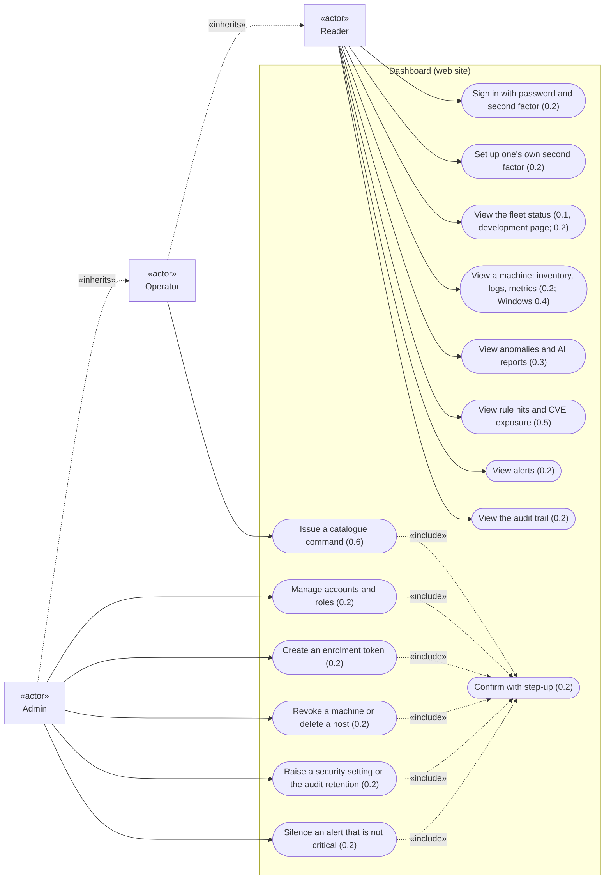
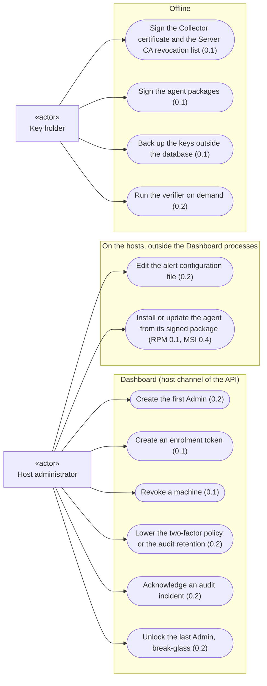
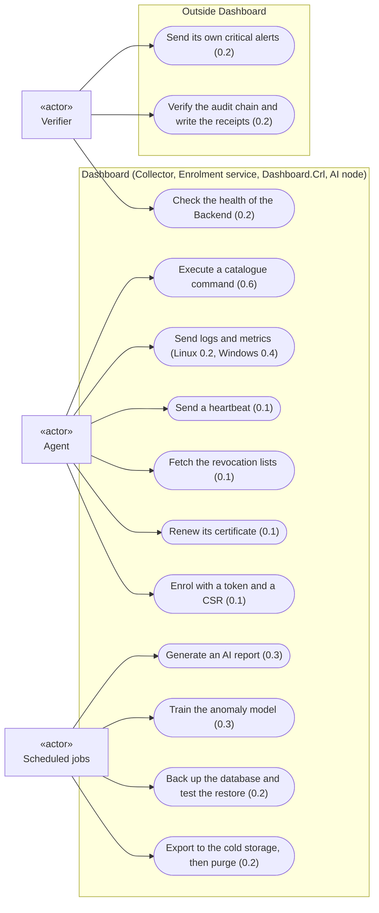

# Use cases of V1

Overview of what each actor can do with Dashboard in V1, drawn from the accepted ADRs. Each use case carries the increment that delivers it (ADR-0015, ADR-0025). The detail of each use case (its steps, its errors) is given by the sequence diagrams of its increment.

The diagrams are written in [Mermaid](https://mermaid.js.org/), which GitHub and Obsidian render in Markdown files. They use the flowchart syntax: Mermaid's dedicated use case diagram exists only from Mermaid 12.0 and is in beta, and the versions embedded by GitHub and Obsidian are **not verified**. Notation used here:

| Shape | Meaning |
|---|---|
| rectangle with «actor» | actor (a person or an external system) |
| rounded box | use case |
| box around use cases | the system boundary |
| solid arrow | the actor takes part in the use case |
| dotted arrow «include» | the use case always includes the other one |
| dotted arrow «inherits» | the role has every right of the other role |

## Actors

| Actor | Kind | Who or what | Source |
|---|---|---|---|
| Reader | person, web site | sees everything, changes nothing | ADR-0014, ADR-0023 |
| Operator | person, web site | Reader, plus issuing the commands of the catalogue | ADR-0014, ADR-0023 |
| Admin | person, web site | Operator, plus accounts, roles and configuration | ADR-0014, ADR-0023 |
| Host administrator | person, on the API host | runs the host commands through the host channel; installs the agents | ADR-0023, ADR-0025 |
| Key holder | person, offline | holds the Server CA key and the package signing keys, backs up the keys outside the database | ADR-0021, ADR-0022, ADR-0025 |
| Agent | external system, on each supervised machine | enrols, reports, executes catalogue commands | ADR-0016, ADR-0021, ADR-0024 |
| Verifier | external system, on another machine | the independent verification tool, enrolled with a "monitor" identity | ADR-0022, ADR-0024, ADR-0025 |
| Scheduled jobs | time | systemd timers on Linux, SQL Server Agent for the backups | ADR-0010, ADR-0012, ADR-0022 |

In the home lab, the host administrator and the key holder are the same person, the product owner. They are two actors because they hold different rights: the host channel on the API host, and keys that never reach that host.

## Web site users

- The status page of 0.1 is for development only and is never deployed elsewhere (ADR-0015).
- Critical alerts cannot be silenced from the web site (ADR-0025).
- Lowering a security setting is not possible from the web site: it goes through the host channel (ADR-0023).

## Host administrator and key holder

- Every host command is audited with the host account that ran it (ADR-0023); a machine revoked and a break-glass unlock raise a critical alert (ADR-0025).
- The "Run the verifier" use case sits in "Offline" for want of a better place: the verifier runs on another machine than the API host, not necessarily offline (ADR-0024).

## Systems and scheduled jobs

- The agent always connects to the Backend; Dashboard never opens a connection to a machine (ADR-0004, ADR-0024).
- The verifier never connects to the database; it reads the exported files and calls the health service of the Collector only (ADR-0024, ADR-0025).
- Agent updates never go through the Collector nor through remote commands (ADR-0025).

## Not decided, or not stated by an ADR

- **What triggers an AI report**: a schedule, a user request, or both. ADR-0009 says the API calls the LLM, not when. Drawn here as a scheduled job, to be confirmed.
- **What triggers the training**: drawn as a scheduled job, because ADR-0010 describes a training task that stops and restarts the LLM service; to be confirmed.
- **The increment of the inventory**: the agent collects an inventory (ADR-0016), shown on the machine page of 0.2; no ADR gives the increment of its collection.
